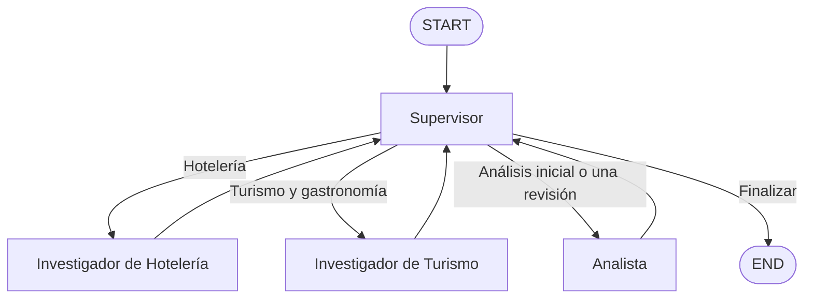

# Pre-entrega 6: orquestador turístico multiagente

## Objetivo

Implementar un asistente turístico con LangGraph que delegue investigaciones de alojamiento, actividades y gastronomía, analice su compatibilidad con un viaje y elabore una respuesta completa o parcial. El Supervisor decide dinámicamente qué especialista interviene y valida la suficiencia del resultado antes de finalizar.

La aplicación usa OpenAI, ejecución asíncrona, contratos Pydantic y persistencia SQLite. Las herramientas consultan catálogos JSON locales; las opciones y los períodos del corpus son datos de demostración, no disponibilidad comercial ni reservas confirmadas.

## Estructura

```text
Pre-entrega6/
├── config.py                              # Configuración validada, límites y rutas
├── schemas.py                             # Solicitud, investigaciones, análisis y decisiones
├── state.py                               # Estado compartido basado en MessagesState
├── llm.py                                 # Construcción de ChatOpenAI
├── tools.py                               # Consultas a catálogos y cálculo de distancias
├── graph.py                               # Grafo jerárquico y aristas condicionales
├── agents/
│   ├── supervisor.py                      # Delegación, suficiencia y respuesta final
│   ├── hoteleria.py                       # Investigación de alojamientos
│   ├── turismo.py                         # Investigación de actividades y gastronomía
│   └── analista.py                        # Compatibilidad y justificación de opciones
├── data/
│   ├── hoteles.json                       # Alojamientos, capacidad y períodos disponibles
│   └── turismo.json                       # Actividades, gastronomía y restricciones conocidas
├── main.py                                # Tres escenarios, SQLite, consola y traza
├── demo_refinamiento.py                    # Omisión controlada y verificación de la prueba
├── Pre_entrega6_Demostracion_Colab.ipynb    # Demostración que reutiliza estos módulos
├── traza_ejecucion.json                    # Evidencia real con decisiones y resultados
├── tests/                                 # Tests locales con modelos simulados
├── requirements.txt                       # Dependencias con versiones fijadas
├── .env.example                           # Plantilla sin credenciales
├── .gitignore                             # Exclusiones de secretos, venv y SQLite
└── README.md
```

## Instalación local

Se requiere Python 3.12 y una API key de OpenAI con acceso y saldo o cuota para el modelo elegido. La suite se comprobó con Python 3.12.15.

Desde la raíz del repositorio:

```bash
cd Pre-entrega6
python3.12 -m venv .venv
source .venv/bin/activate
python -m pip install -r requirements.txt
python -m pip check
cp .env.example .env
```

Completar la clave en `.env`. Los comandos siguientes se ejecutan desde `Pre-entrega6/`.

## Variables

| Variable | Predeterminado | Uso |
| --- | --- | --- |
| `OPENAI_API_KEY` | Obligatoria, sin valor | Credencial de OpenAI |
| `OPENAI_MODEL` | `gpt-6.1-sol` | Modelo con herramientas y salida estructurada |
| `OPENAI_TIMEOUT_SECONDS` | `30` | Timeout del cliente del modelo |
| `OPENAI_MAX_TOKENS` | `4096` | Máximo enviado como `max_completion_tokens` |
| `OPENAI_REASONING_EFFORT` | Vacío | Esfuerzo opcional: `low`, `medium`, `high`, `xhigh` o `max` |
| `RECURSION_LIMIT` | `10` | Límite de pasos del grafo por escenario |

El esfuerzo vacío se convierte en `None` y se omite; el modelo utiliza su comportamiento predeterminado. No se envía temperatura y los reintentos automáticos del SDK están desactivados. Si se cambia el modelo, debe admitir los parámetros utilizados.

Pydantic valida la presencia de la clave, el modelo y los límites. La clave usa `SecretStr` y no se muestra en representaciones ni mensajes de error. Los módulos no realizan solicitudes al importarse.

`max_completion_tokens` incluye salida y, cuando corresponde, tokens de razonamiento. Si una respuesta estructurada se trunca, se informa un error específico para revisar `OPENAI_MAX_TOKENS`, sin reintentar automáticamente.

## Arquitectura y responsabilidades



La topología permite coordinar tareas de distintos dominios sin fijar el orden entre Hotelería y Turismo. La ejecución es secuencial y asíncrona. El Supervisor selecciona la ruta mediante una salida estructurada; las aristas condicionales usan un retorno tipado con `Literal`.

- **Supervisor:** extrae la solicitud, elige la siguiente tarea, aplica su rúbrica y redacta la respuesta final.
- **Hotelería:** consulta únicamente la herramienta de alojamientos y conserva sus datos.
- **Turismo:** consulta únicamente la herramienta de actividades, miradores y gastronomía.
- **Analista:** contrasta la solicitud con las investigaciones disponibles. No realiza nuevas búsquedas ni decide el cierre.

Cada investigador usa el LLM para formular una consulta a su herramienta asignada. El resultado se valida y se devuelve directamente, evitando reescribir los registros con el modelo. Las consultas filtran por destino, sin descartar opciones por fechas o cantidad de viajeros: la compatibilidad corresponde al Analista.

Los especialistas reciben la solicitud y la tarea concreta, no todo el historial. Cada uno actualiza su propio grupo de resultados. El Analista conserva referencias a los IDs originales y no modifica las investigaciones. Los controles del estado impiden delegaciones incompatibles, repeticiones de investigación y cierre prematuro; no eligen agentes por palabras clave del usuario.

## Solicitud, fuentes y análisis

Los datos mínimos son destino, fecha de inicio, fecha de fin y cantidad de viajeros; también se identifican los componentes solicitados. Si faltan datos, el sistema informa cuáles y finaliza sin delegar. No continúa una conversación de aclaración multivuelta. Las consultas ajenas al dominio turístico también finalizan sin investigaciones.

Los catálogos incluyen IDs, fuente, coordenadas y datos conocidos de períodos y capacidad. Las herramientas realizan lecturas reales de esos archivos con `asyncio.to_thread()`. Una búsqueda completada con lista vacía se distingue de un error de consulta, y `None` en el estado identifica una investigación aún no ejecutada.

El Analista recibe comprobaciones calculadas en Python:

- Capacidad suficiente del alojamiento para el grupo.
- Cobertura completa de la estadía por los períodos del alojamiento, incluyendo tramos contiguos.
- Coincidencia de algún período de la actividad con las fechas del viaje.
- Distancia en línea recta mediante Haversine respecto de Tokyo Station, en Tokio, usando las coordenadas aproximadas `35.6812, 139.7671`.

Las distancias son informativas; no representan recorridos o tiempos de traslado ni provocan rechazo por umbrales. Si no hay coordenadas, no se inventan distancias.

Las clasificaciones son `compatible`, `pendiente_verificacion` e `incompatible`, con justificación individual. Una incompatibilidad requiere evidencia que contradiga lo solicitado. La falta de información sólo requiere verificación cuando es necesaria para evaluar una condición solicitada.

Precios, horarios exactos, cupos o reservas no solicitados no bloquean automáticamente recomendaciones generales. En turismo, `capacidad_suficiente=null` no representa cupo insuficiente: esa comprobación corresponde a alojamiento. Las observaciones informativas pueden acompañar opciones compatibles sin confirmar reservas.

## Supervisión, conflictos y refinamiento

El Supervisor aplica una rúbrica cualitativa:

| Evaluación interna | Criterio |
| --- | --- |
| `aprobado` | Componentes solicitados cubiertos, análisis suficiente y sin incumplimientos relevantes |
| `aprobado_con_advertencias` | Información útil, con componentes sin resolver o limitaciones relevantes |
| `desaprobado` | Evidencia insuficientemente útil o confiable para responder adecuadamente |

Los resultados de una rama no invalidan automáticamente los de otra. Por ejemplo, hoteles incompatibles con marzo no impiden recomendar actividades disponibles. La ausencia de opciones en estos catálogos no se presenta como ausencia de disponibilidad en todo el destino.

Si el primer análisis tiene una omisión o defecto concreto, el Supervisor puede devolverlo **una sola vez** al Analista con una instrucción específica. El contador `refinamientos_analista` aumenta al solicitar esa devolución; el primer análisis no lo consume. El Analista recibe su resultado anterior y las investigaciones originales y devuelve la versión revisada. El estado reemplaza el análisis anterior y la traza conserva las dos intervenciones.

Una limitación de la fuente no justifica por sí sola un refinamiento. No se repiten investigaciones ni solicitudes fallidas de APIs. Tras la única revisión, sólo se permite finalizar; las omisiones relevantes persistentes deben comunicarse sin dar por resuelto el pedido. El límite de recursión protege además la ejecución completa y cuenta pasos, no solicitudes al modelo.

La respuesta al viajero contiene recomendaciones y limitaciones en lenguaje natural. Calificaciones internas, IDs y nombres de archivos quedan en el estado y en los bloques de diagnóstico, fuera de `respuesta_final`.

## Ejecución y evidencia

```bash
.venv/bin/python main.py
```

Se ejecutan tres escenarios con threads independientes y nuevos en cada corrida:

| Escenario | Solicitud | Resultado real incluido |
| --- | --- | --- |
| `respuesta_completa` | Tokio, 12–20 de febrero de 2027, cuatro personas; alojamiento, actividades y gastronomía | `aprobado`, cinco opciones compatibles y ningún refinamiento |
| `respuesta_parcial` | Mismo pedido para el 12–20 de marzo de 2027 | `aprobado_con_advertencias`: hoteles incompatibles por fechas, turismo compatible; ningún refinamiento |
| `prueba_refinamiento_controlado` | Solicitud válida de febrero, con una omisión introducida sólo en el primer análisis | Cuatro evaluaciones, feedback concreto del Supervisor, cinco evaluaciones tras la revisión y cierre `aprobado` |

La consola muestra las decisiones y contribuciones a partir de las actualizaciones emitidas por LangGraph. `AsyncSqliteSaver` conserva el estado en `checkpoints.sqlite`, con autorización explícita de los tipos propios para deserializar los checkpoints. Los threads nuevos aíslan las corridas; no eliminan el historial anterior.

La [traza de ejecución](traza_ejecucion.json) incluye solicitud, thread, eventos y estado final por escenario. Registra resultados observables, no razonamiento interno del modelo. La traza se guarda de forma atómica y SQLite y sus auxiliares permanecen locales, excluidos de Git junto con `.env` y `.venv/`.

### Prueba controlada de refinamiento

El tercer escenario reutiliza el mismo grafo y Supervisor. Sólo sustituye la implementación del nodo Analista por un envoltorio de demostración:

1. Ejecuta al Analista real y exige que las investigaciones y su resultado inicial cubran las cinco opciones.
2. Quita de una copia únicamente la evaluación de `turismo-tokio-03`, sin modificar catálogos, investigaciones ni el resultado original.
3. El Supervisor recibe el análisis incompleto sin una instrucción que lo obligue a refinar ni los metadatos de control de la prueba.
4. Si solicita revisión, el segundo análisis se devuelve sin alteraciones.

La prueba exige una devolución con feedback concreto, recuperación de las cinco evaluaciones, una única revisión, cierre y una sola ejecución de cada investigador. El feedback se verifica con un criterio textual conservador: debe identificar la evaluación gastronómica o la cobertura de cuatro frente a cinco opciones, además de la evaluación faltante. No es un juez semántico general; la instrucción exacta se conserva para revisión humana.

Si el Supervisor no detecta la omisión, pide una revisión genérica, no se cumplen las precondiciones o la corrección resulta insuficiente, la prueba se registra como **no satisfactoria**. También se conservan los eventos y el tipo de error si se interrumpe esta prueba. No se corrige su decisión artificialmente.

La demostración guarda la traza del tercer escenario tanto si la prueba pasa como si falla. Una prueba no satisfactoria termina con código `1`, aunque el grafo haya cerrado normalmente. Un error anterior en los escenarios habituales conserva la traza previa, que no representa la corrida fallida.

### Ejemplo real de delegación y corrección

```text
respuesta_completa: aprobado; refinamientos = 0
respuesta_parcial: aprobado_con_advertencias; refinamientos = 0

prueba_refinamiento_controlado:
Supervisor → Hotelería → Supervisor → Turismo → Supervisor
→ Analista (4 opciones) → Supervisor → Analista (5 opciones) → Supervisor

Feedback del Supervisor:
“Completá el análisis incorporando la evaluación individual omitida del
Restaurante Jardín Sakura y su recomendación gastronómica.”

Evaluación interna: aprobado; refinamientos = 1
Prueba de refinamiento satisfactoria. Demostración finalizada.
```

El fragmento de feedback se reproduce de la ejecución incluida; la instrucción completa está en el JSON. Las dos investigaciones se ejecutaron una sola vez. La respuesta parcial comunica que no se encontró alojamiento compatible en las fuentes consultadas y conserva las recomendaciones turísticas.

## Ejecutar desde Google Colab

[Abrir el notebook en Colab](https://colab.research.google.com/github/mcolatto/curso-ai-engineering/blob/main/Pre-entrega6/Pre_entrega6_Demostracion_Colab.ipynb)

1. Abrir el notebook e iniciar un entorno Python 3.12 o posterior con CPU.
2. En **Secretos** (ícono de llave), crear `OPENAI_API_KEY` y habilitar su acceso al notebook.
3. Ejecutar las celdas en orden. La primera clona automáticamente el repositorio público y comprueba las rutas; no se deben subir archivos manualmente.
4. Instalar las dependencias desde `requirements.txt` y leer el secreto mediante `google.colab.userdata`, sin imprimirlo ni escribirlo en `.env`.
5. Ejecutar la demostración, revisar la traza nueva y descargarla con la celda opcional.

El notebook reutiliza `main.py` mediante `await`, sin duplicar agentes ni llamar a `asyncio.run()` dentro del event loop de Colab. Usa la rama `main` y muestra el commit ejecutado. Si ya hay un clon en la sesión, lo reutiliza; para descargar una publicación más reciente, iniciar un entorno nuevo. Si la carpeta no está publicada completa, informa el requisito pendiente antes de instalar dependencias.

La celda de instalación aplica un ajuste específico para el entorno de Colab: después de instalar `requirements.txt`, instala `jedi` para IPython y fija `langchain-core==1.7.4` para compatibilidad con el `langchain` preinstalado. Luego ejecuta `pip check`. El entorno local conserva las versiones declaradas en `requirements.txt`.

El notebook se validó mediante una ejecución real en Google Colab: `pip check` finalizó correctamente y los tres escenarios completaron su recorrido. Febrero terminó `aprobado`, marzo `aprobado_con_advertencias` y la prueba controlada fue satisfactoria con un único refinamiento. El Supervisor identificó expresamente la evaluación omitida del Restaurante Jardín Sakura y solicitó completarla sin nuevas búsquedas.

Los archivos SQLite de Colab son temporales. La traza del repositorio no se presenta como evidencia de una corrida nueva si ésta falla antes de generarla.

## Tests y consumo

```bash
.venv/bin/python -m unittest discover -s tests -v
```

La suite contiene **87 tests** y se ejecuta sin llamadas a OpenAI. Comprueba configuración, contratos, estado compartido, catálogos, distancias, investigadores, Supervisor, rutas, persistencia, límites, trazas, refinamiento y celdas del notebook. Usa grafo, herramientas locales y SQLite reales con decisiones del modelo simuladas. Estos tests no demuestran por sí solos la calidad semántica de un LLM; la traza incluida corresponde a una ejecución real satisfactoria de los tres escenarios.

La ejecución real incluida realizó **23 llamadas al modelo**: siete por escenario normal y nueve en la prueba controlada. Cada refinamiento agrega dos llamadas: Analista y Supervisor. Dentro del recorrido permitido, cada escenario puede alcanzar nueve llamadas. El límite de recursión no equivale a un presupuesto monetario.

Las herramientas leen JSON y calculan distancias localmente, sin APIs de viajes, mapas ni embeddings. Los fallos de APIs, truncamiento o configuración se comunican sin traceback ni detalles sensibles. Repetir la demostración o las celdas de ejecución vuelve a consumir saldo o cuota de OpenAI y puede producir decisiones o textos distintos.
