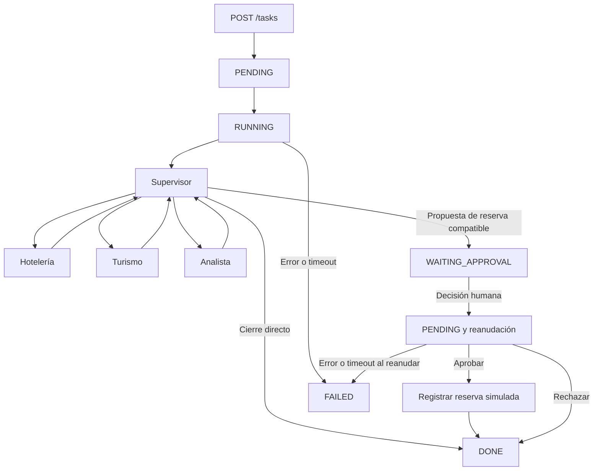

# Preentrega 7 · API asíncrona y monitoreo activo

API de FastAPI que expone un orquestador turístico de LangGraph. El Supervisor delega las consultas a Hotelería y Turismo, recibe el análisis de compatibilidad y devuelve recomendaciones. Los trabajos se ejecutan en segundo plano, Redis guarda sus estados y checkpoints, y LangSmith registra el árbol de ejecución. Una reserva hotelera simulada requiere aprobación humana antes de registrarse.

Las herramientas consultan catálogos JSON locales; las opciones y los períodos del corpus son datos de demostración, no disponibilidad comercial ni reservas confirmadas.

## Puesta en marcha

Se necesita Docker con Compose y una clave de OpenAI con acceso al modelo configurado. La imagen de la API usa Python 3.12.15. Para la prueba de concurrencia también se necesita una clave de LangSmith con permiso para enviar y leer trazas y publicar el feedback del p95.

Desde la raíz del repositorio:

```bash
cd Pre-entrega7
cp -n .env.example .env
```

Completá `OPENAI_API_KEY` en el archivo local `.env`. Para activar el monitoreo, completá `LANGSMITH_API_KEY` y configurá `LANGSMITH_TRACING=true`.

```bash
docker compose up --build --wait
```

Compose espera que Redis esté saludable y que FastAPI responda por HTTP. Swagger queda disponible en [localhost:8000/docs](http://127.0.0.1:8000/docs). Redis se comunica con la API por la red interna de Compose y conserva los datos en un volumen con AOF. `docker compose down` detiene el entorno y conserva el volumen. [Referencia de Docker Compose](https://docs.docker.com/reference/cli/docker/compose/up/)

| Variable | Valor inicial | Uso |
| --- | --- | --- |
| `OPENAI_API_KEY` | Obligatoria | Credencial del modelo |
| `OPENAI_MODEL` | `gpt-6.1-sol` | Modelo del orquestador |
| `OPENAI_TIMEOUT_SECONDS` | `30` | Tiempo límite de una llamada al modelo |
| `OPENAI_MAX_TOKENS` | `4096` | Límite de tokens de salida por llamada |
| `OPENAI_REASONING_EFFORT` | Vacío | Ajuste opcional para modelos compatibles |
| `RECURSION_LIMIT` | `10` | Límite de pasos del grafo por invocación |
| `JOB_TIMEOUT_SECONDS` | `300` | Tiempo límite de ejecución del grafo por tramo |
| `REDIS_URL` | `redis://redis:6379/0` | Dirección interna de Redis |
| `LANGSMITH_TRACING` | `false` | Activa la instrumentación |
| `LANGSMITH_API_KEY` | Vacía | Obligatoria cuando se activa el monitoreo |
| `LANGSMITH_PROJECT` | `preentrega7` | Proyecto de trazas |

En un workspace organizado por agentes, registrá el agente en LangSmith e indicá `LANGSMITH_AGENT_ID` y, si corresponde, `LANGSMITH_AGENT_ENVIRONMENT` (predeterminado `local`). El destino por agente tiene prioridad sobre el nombre de proyecto. Las variables `LANGSMITH_ENDPOINT` y `LANGSMITH_WORKSPACE_ID` permiten indicar la región o el workspace cuando la cuenta lo requiere. [Configuración de LangSmith](https://docs.langchain.com/langsmith/trace-with-langgraph#2-configure-your-environment)

## Uso de la API

| Método y ruta | Comportamiento |
| --- | --- |
| `POST /tasks` | Acepta un `prompt`, guarda el trabajo en Redis y devuelve `202` con `job_id` y `PENDING`. El encabezado opcional `X-Batch-ID` agrupa las trazas de una corrida. |
| `GET /tasks/{job_id}` | Consulta el estado, las marcas de tiempo, la propuesta pendiente, el resultado o el error, según corresponda. |
| `POST /tasks/{job_id}/approve` | Recibe `{"decision":"aprobar"}` o `{"decision":"rechazar"}` y devuelve `202` si el trabajo estaba esperando esa decisión. Una decisión repetida devuelve `409`. |

Un ID inexistente devuelve `404`, una entrada inválida devuelve `422` y una operación HTTP que no puede acceder a Redis devuelve `503`.

### Consulta normal

```bash
curl -sS -X POST http://127.0.0.1:8000/tasks \
  -H 'Content-Type: application/json' \
  -d '{"prompt":"Quiero viajar a Tokio del 12 al 20 de febrero de 2027. Somos cuatro personas y buscamos alojamiento, actividades turísticas y gastronomía."}'
```

Copiá el ID devuelto y repetí el GET hasta que el trabajo alcance `DONE` o `FAILED`:

```bash
curl -sS "http://127.0.0.1:8000/tasks/<job_id>"
```

En `DONE`, el texto del orquestador está en `result.respuesta`. La consulta de estado lee Redis. Las llamadas al modelo ocurren en el worker.

### Aprobación humana

Desde Swagger, creá otro trabajo con el siguiente prompt:

> Quiero viajar a Tokio del 12 al 20 de febrero de 2027. Somos cuatro personas. Organizá el viaje y gestioná una reserva hotelera simulada en un hotel compatible.

1. Consultá el ID nuevo hasta ver `WAITING_APPROVAL`. Revisá el hotel, las fechas y la cantidad de viajeros en `accion_pendiente`.
2. Usá ese mismo ID en `POST /tasks/{job_id}/approve` y enviá `{"decision":"aprobar"}`.
3. Consultá otra vez el trabajo. En `DONE` debe aparecer `decision_aprobacion: "aprobar"` y una referencia de reserva simulada `SIM-…`.
4. Para comprobar el rechazo, creá otro trabajo y enviá `{"decision":"rechazar"}` cuando esté pausado. El resultado final debe indicar que se rechazó la propuesta y no se realizó una reserva.

El Supervisor extrae la intención del prompt. El grafo propone el primer alojamiento del catálogo clasificado como compatible cuya capacidad y cobertura de fechas se pueden comprobar. Si no hay un candidato, el flujo termina con la explicación correspondiente. Con un candidato, LangGraph guarda la pausa antes de que la herramienta de reserva pueda ejecutarse. El worker reanuda el mismo `thread_id` con la decisión y la propuesta presentada. Redis admite una sola decisión por pausa y una sola reserva simulada por trabajo, incluso si se repite una escritura.

## Orquestación y persistencia



FastAPI delega mediante tareas asíncronas dentro de un proceso Uvicorn. El worker admite hasta cinco ejecuciones activas y libera el cupo al entrar en espera de aprobación. El Supervisor puede devolver el análisis al Analista para un refinamiento acotado antes de cerrar. Los catálogos locales permiten entregar una respuesta parcial cuando faltan opciones para alguna parte del viaje.

Cada `job_id` identifica tanto su registro en Redis como su hilo de LangGraph. Redis 8.10.3 provee RedisJSON y RediSearch para el checkpointer asíncrono. Al reiniciar la API, se conservan los trabajos que esperan una decisión y se registran como `FAILED` los trabajos activos que quedaron huérfanos. Durante una caída de Redis, la consulta devuelve `503` y la reconciliación ocurre cuando vuelve a arrancar la API. [Checkpointer de Redis](https://github.com/redis-developer/langgraph-redis/blob/main/docs/user_guide/checkpointers.md)

## Prueba de concurrencia

Con el monitoreo activo y el proyecto ya identificado en LangSmith, ejecutá desde `Pre-entrega7/`:

```bash
docker compose up --build --wait
docker compose exec api python -m scripts.prueba_concurrencia --salida /tmp/lote-nuevo.json
docker compose cp api:/tmp/lote-nuevo.json ./lote-nuevo.json
```

El script envía cinco veces en paralelo el prompt de consulta normal. Cada ejecución consume API de OpenAI. Si las métricas demoran, se puede volver a consultar LangSmith con el JSON existente, sin crear otro lote:

```bash
docker compose exec api python -m scripts.prueba_concurrencia --recolectar /tmp/lote-nuevo.json
docker compose cp api:/tmp/lote-nuevo.json ./lote-nuevo.json
```

El JSON del contenedor se puede copiar al host para conservarlo si se recrea el servicio. En ese caso, para continuar la recolección, restauralo primero con `docker compose cp ./lote-nuevo.json api:/tmp/lote-nuevo.json`. Si hay varios destinos o el nombre del proyecto no identifica el entorno deseado, se puede pasar su UUID con `--project-id` al lanzar el lote.

El reporte separa el tiempo de aceptación del POST, medido en milisegundos en el cliente, de la duración de la traza raíz, medida en segundos por LangSmith. Los tokens y costos corresponden a los agregados de cada traza. Un lote con trabajos fallidos o métricas faltantes queda incompleto.

En LangSmith, el ID de la traza inicial es el `job_id`. La reanudación de una aprobación genera otra traza con el mismo `job_id` y `thread_id` en sus metadatos. Las cinco trazas de la prueba se identifican con el tag `lote:<lote_id>`.

### Cálculo del p95

El gráfico estándar **Trace Latency** del entorno usado para esta entrega muestra P50 y P99. Para obtener el **P95 específico del lote**, el script ordena las cinco duraciones de traza y toma el rango `ceil(0,95 × 5) = 5`, es decir, la mayor duración. Luego publica ese valor de lote como un único feedback `latencia_p95_s`, en segundos, asociado a una de las cinco trazas. **Feedback Scores** muestra `Avg` porque promedia los valores de esa clave en el período. En esta captura hay una sola publicación, por lo que el valor mostrado coincide con el p95 calculado. [Métricas del dashboard de LangSmith](https://docs.langchain.com/langsmith/dashboards)

### Resultados registrados

Lote `e542b78f-dc79-4f71-841c-5369430429d4`, ejecutado el 16 de noviembre de 2026. Los cinco trabajos quedaron en `DONE`. Los UUID completos y las marcas de tiempo figuran en el [reporte JSON](lote-1.json).

| Trabajo | Aceptación HTTP (ms) | Latencia de traza (s) | Tokens | Costo estimado (USD) |
| --- | ---: | ---: | ---: | ---: |
| 1 | 46,406 | 38,146 | 12.672 | 0,0335419 |
| 2 | 239,608 | 36,903 | 12.801 | 0,0340564 |
| 3 | 238,309 | 40,193 | 13.041 | 0,0356714 |
| 4 | 251,070 | 37,661 | 12.826 | 0,0343119 |
| 5 | 251,138 | 39,797 | 12.908 | 0,0348414 |

**P95 del lote: 40,1931 s. Costo total estimado: USD 0,172423.** Estas cifras corresponden a esta corrida de cinco solicitudes.

- [Árbol de una ejecución individual](screenshots/evidencia_arbol_de_ejecucion.png)
- [Cinco trazas del lote con latencia, tokens y costo por ejecución](screenshots/latencia_p95_5_concurrencias.png)
- [P95 publicado en Feedback Scores](screenshots/Feedback_scores_p95.png)

## Estructura y pruebas

| Componente | Responsabilidad |
| --- | --- |
| `main.py`, `worker.py`, `jobs.py` | API, ejecución en segundo plano y estados persistidos |
| `graph.py`, `state.py`, `schemas.py`, `agents/` | Ruteo, estado, contratos y agentes del orquestador |
| `tools.py`, `data/`, `hitl.py` | Consultas al catálogo y reserva simulada con aprobación |
| `checkpoints.py`, `observability.py` | Persistencia del grafo y correlación de trazas |
| `scripts/prueba_concurrencia.py`, `screenshots/` | Prueba de carga y evidencia de resultados |
| `tests/` | Pruebas HTTP, grafo, persistencia y métricas |

Para correr la suite local desde `Pre-entrega7/`:

```bash
python3.12 -m venv .venv
.venv/bin/python -m pip install -r requirements.txt
.venv/bin/python -m pip check
.venv/bin/python -m unittest discover -s tests
```

Las pruebas usan respuestas simuladas para OpenAI y LangSmith. La prueba de integración con Redis se habilita con `TEST_REDIS_URL` apuntando a una instancia descartable de Redis 8, con RedisJSON y RediSearch. Comprueba cinco trabajos simultáneos, checkpoints separados y recuperación del estado tras reiniciar el ciclo de vida de la API.
