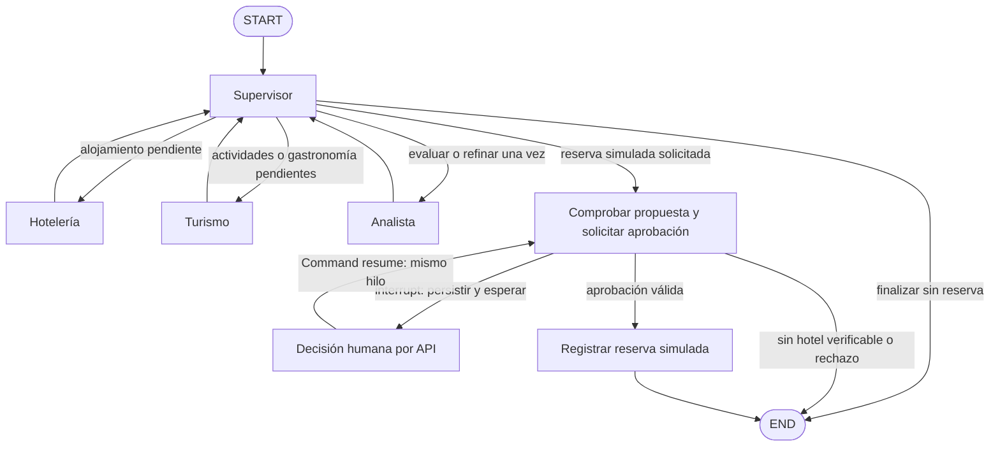

# Orquestador turístico multiagente

Sistema que recibe solicitudes de viaje mediante una API, investiga alojamiento, actividades y gastronomía, evalúa su compatibilidad y devuelve recomendaciones. Un Supervisor coordina especialistas con LangGraph y puede solicitar una revisión concreta del análisis antes de responder.

La API procesa trabajos en segundo plano, conserva estados y checkpoints en Redis y registra trazas en LangSmith. Si el usuario solicita una reserva hotelera simulada, el grafo se pausa antes de registrarla y espera una decisión humana por HTTP.

Las herramientas consultan catálogos JSON locales; las opciones y los períodos del corpus son datos de demostración, no disponibilidad comercial ni reservas confirmadas.

## Inicio con Docker Compose

Requisitos: Docker con motor iniciado y Compose disponible, una clave de OpenAI y, para observar ejecuciones, una cuenta y clave de LangSmith. Python 3.12.15 y las dependencias se instalan en la imagen; no se necesita una instalación local de Python ni un entorno virtual.

Desde la raíz del repositorio:

```bash
cd Proyecto-final
cp .env.example .env
# Completar OPENAI_API_KEY y LANGSMITH_API_KEY en .env.
# Configurar LANGSMITH_TRACING=true para registrar las trazas.
docker compose up --build --wait
```

Abrir [Swagger](http://127.0.0.1:8000/docs) para probar la API o consultar [OpenAPI](http://127.0.0.1:8000/openapi.json). El arranque valida la configuración y conecta Redis, pero no realiza consultas al modelo. Crear un trabajo sí puede generar consumo de OpenAI; los scripts de demostración también.

Compose inicia dos servicios: `api` y `redis`. La API se publica solamente en `127.0.0.1:8000`; Redis permanece en la red interna. Si el puerto está ocupado, detener el servicio que lo utiliza antes del arranque.

```bash
docker compose ps
docker compose logs --tail=50 api
docker compose down
```

`down` conserva el volumen `proyecto-final_redis-final-data`. Agregar `--volumes` elimina sus trabajos, checkpoints y reservas simuladas: usarlo sólo cuando se quiera descartar esos datos. Tras cambiar `.env` o código, volver a ejecutar `docker compose up --build --wait`.

## Arquitectura y responsabilidades



`Humano` representa la intervención externa, no un nodo adicional. Las aristas desde el Supervisor son condicionales: no hay un orden fijo entre investigadores. Cada trabajo ejecuta sus especialistas secuencialmente; distintos trabajos pueden avanzar concurrentemente.

| Componente | Responsabilidad |
|---|---|
| Supervisor | Extraer la solicitud, delegar, evaluar suficiencia y redactar la respuesta final. Sus decisiones son estructuradas y las rutas se validan contra el estado. |
| Hotelería | Usar exclusivamente `buscar_hoteles` para recuperar opciones del destino, conservando sus datos y procedencia. |
| Turismo | Usar exclusivamente `buscar_turismo` para recuperar actividades y gastronomía. |
| Analista | Evaluar fechas, capacidad, restricciones y preferencias explícitas; clasificar cada opción y conservar su ID original. |
| Herramientas | Leer los catálogos por destino. No filtrar por fechas o viajeros: esa evaluación corresponde al Analista. |
| API y worker | Aceptar solicitudes, ejecutar o reanudar el grafo y actualizar el estado del trabajo. |
| Redis | Guardar registros de trabajos, checkpoints y reservas simuladas. |
| LangSmith | Registrar agentes, herramientas, llamadas al modelo, tiempos, tokens y costos. |

El estado compartido extiende `MessagesState`: contiene la solicitud, investigaciones, análisis, decisión del Supervisor y campos HITL. Distingue una búsqueda no ejecutada, completada vacía y fallida. Las opciones pueden ser `compatible`, `incompatible` o `pendiente_verificacion`, con justificación.

La ausencia de información no equivale a incompatibilidad. Tampoco impide una recomendación general que falten precios, horarios o confirmaciones de mesas que el usuario no pidió. Las distancias se calculan en Python, en línea recta desde Tokyo Station; son informativas y no se usa un umbral automático de rechazo.

## Flujos y criterios de cierre

- **Completo:** las investigaciones cubren los componentes pedidos y el análisis es suficiente. Evaluación interna: `aprobado`.
- **Parcial:** se conservan recomendaciones útiles aunque otro componente no pueda resolverse. Evaluación interna: `aprobado_con_advertencias`; sin evidencia útil suficiente, `desaprobado`.
- **Refinamiento:** ante una omisión concreta del análisis, el Supervisor puede devolverlo una única vez al Analista con una instrucción específica. Se reutilizan las investigaciones; no se repiten búsquedas. Una limitación del catálogo no exige por sí sola refinar.
- **Solicitud incompleta:** si faltan destino, fechas o cantidad de viajeros, se informan los datos faltantes y se finaliza sin investigar. Los pedidos ajenos al dominio también finalizan sin delegación.
- **Reserva simulada:** la intención se interpreta desde el prompt. No existe un parámetro adicional que contradiga lo pedido por el usuario.

La calificación interna y las rutas de archivos quedan en el estado y las trazas; la respuesta al viajero comunica recomendaciones y limitaciones en lenguaje natural.

## API y ejemplos

| Método y ruta | Contrato |
|---|---|
| `POST /tasks` | Recibe `{"prompt": "..."}` y devuelve HTTP 202 con `job_id` y `status: PENDING`, sin esperar el resultado del grafo. Acepta el encabezado opcional `X-Batch-ID` con UUID. |
| `GET /tasks/{job_id}` | Devuelve estado, fechas y, según corresponda, `result.respuesta`, `accion_pendiente` o `error`. |
| `POST /tasks/{job_id}/approve` | Recibe `{"decision":"aprobar"}` o `{"decision":"rechazar"}`. Devuelve HTTP 202 y reanuda el mismo trabajo. |

Consultar nuevamente el `GET` hasta alcanzar un estado terminal o una pausa. Un HTTP 202 confirma aceptación, no éxito del procesamiento.

```bash
curl -X POST http://127.0.0.1:8000/tasks \
  -H 'Content-Type: application/json' \
  -d '{"prompt":"Quiero viajar a Tokio del 12 al 20 de febrero de 2027. Somos cuatro personas y buscamos alojamiento, actividades turísticas y gastronomía."}'

# Copiar el UUID real devuelto por POST:
curl http://127.0.0.1:8000/tasks/UUID_DEL_TRABAJO
```

Para observar la respuesta parcial, cambiar febrero por marzo de 2027. Los hoteles del catálogo no cubren esas fechas; actividades y gastronomía sí pueden recomendarse.

Para HITL, crear otro trabajo:

```bash
curl -X POST http://127.0.0.1:8000/tasks \
  -H 'Content-Type: application/json' \
  -d '{"prompt":"Quiero viajar a Tokio del 12 al 20 de febrero de 2027. Somos cuatro personas. Buscamos alojamiento, actividades turísticas y gastronomía, y gestionar una reserva hotelera simulada en un hotel compatible."}'
```

Cuando el `GET` indique `WAITING_APPROVAL`, revisar `accion_pendiente`: hotel, fechas y viajeros. Se elige el primer hotel del catálogo clasificado como compatible cuya capacidad y cobertura temporal se verifican en código. Si no existe una propuesta verificable, no se solicita autorización ni se registra una reserva.

```bash
curl -X POST http://127.0.0.1:8000/tasks/UUID_DEL_TRABAJO/approve \
  -H 'Content-Type: application/json' -d '{"decision":"aprobar"}'

# Para probar el rechazo, crear otro trabajo y usar SU UUID:
curl -X POST http://127.0.0.1:8000/tasks/OTRO_UUID/approve \
  -H 'Content-Type: application/json' -d '{"decision":"rechazar"}'
```

La aprobación registra una simulación con referencia `SIM-<job_id>`; el rechazo finaliza sin reserva. No se contactan hoteles ni se realizan pagos. El registro usa `SET NX` y comprueba que una reserva existente coincida, evitando duplicados para el mismo trabajo.

Los estados son `PENDING → RUNNING → DONE/FAILED` o `RUNNING → WAITING_APPROVAL → PENDING → RUNNING → DONE/FAILED`. Los errores de validación HTTP producen 422; trabajo inexistente, 404; decisión duplicada o fuera de una pausa, 409; Redis inaccesible durante una petición, 503.

## Persistencia, asincronía y límites operativos

FastAPI agenda corrutinas con `asyncio.create_task`; un semáforo permite hasta cinco trabajos activos. Las operaciones con el modelo, Redis y el grafo son asíncronas. La lectura local de los JSON se desplaza a un hilo con `asyncio.to_thread`.

El checkpointer es `AsyncRedisSaver`, con inicialización de índices y serialización de los tipos Pydantic del estado. Redis 8.10.3 incluye RedisJSON y RediSearch, necesarios para esta implementación. Compose fija su imagen mediante digest y configura AOF con `appendfsync always` sobre un volumen propio.

Cada trabajo tiene `thread_id = job_id`. La invocación inicial usa ese UUID como `run_id`; una reanudación crea otra traza raíz y conserva `job_id` y `thread_id` en sus metadatos. `interrupt()` guarda la pausa antes de `END`; `Command(resume=...)` aplica la decisión sobre esa misma propuesta.

Al reiniciar la API se conservan las pausas `WAITING_APPROVAL`. Los trabajos huérfanos en `PENDING` o `RUNNING` se marcan `FAILED`: no hay una cola duradera que los reejecute automáticamente. El worker también controla excepciones, cancelación y timeout. Si Redis está caído, puede ser imposible persistir `FAILED` en ese momento; se registra el problema y la recuperación de huérfanos se realiza al arrancar nuevamente.

La aplicación está diseñada para **un único proceso de API** (`--workers 1`), sin Celery ni otro servicio de procesamiento. No implementa autenticación de usuarios, inventario comercial ni despliegue distribuido. La API se expone localmente para la demostración.

## Configuración

Las credenciales se guardan en `.env`, excluido de Git y de la imagen Docker. `.env.example` documenta los nombres sin secretos. No se crean clientes al importar los módulos; la API abre y cierra los recursos en su ciclo de vida.

| Variable | Predeterminado o uso |
|---|---|
| `OPENAI_API_KEY` | Obligatoria para la aplicación; no se valida su autenticidad durante el arranque. |
| `OPENAI_MODEL` | `gpt-6.1-sol`; requiere acceso al modelo indicado en la cuenta. |
| `OPENAI_TIMEOUT_SECONDS` | `30`, timeout del cliente del modelo. |
| `OPENAI_MAX_TOKENS` | `4096`, máximo de salida por llamada. |
| `OPENAI_REASONING_EFFORT` | Vacío: no enviar el parámetro. Su compatibilidad depende del modelo elegido. |
| `RECURSION_LIMIT` | `10`, límite de pasos de LangGraph; no equivale al número de llamadas al modelo. |
| `REDIS_URL` | `redis://redis:6379/0`, dirección interna de Compose. |
| `JOB_TIMEOUT_SECONDS` | `300` por invocación del worker, incluida la reanudación; no limita el tiempo de espera humana. |
| `LANGSMITH_TRACING` | `false`; activar con `true` para enviar trazas. |
| `LANGSMITH_API_KEY` | Obligatoria cuando el trazado está activo. |
| `LANGSMITH_PROJECT` | `proyecto-final`, destino cuando no se configura agente. |
| `LANGSMITH_AGENT_ID` | Opcional, ID del agente registrado en LangSmith; tiene prioridad sobre el proyecto. |
| `LANGSMITH_AGENT_ENVIRONMENT` | `local`; también admite `development`, `staging` o `production`. |
| `LANGSMITH_ENDPOINT`, `LANGSMITH_WORKSPACE_ID` | Opcionales, consumidas por el SDK para otros endpoints o workspaces. |

El cliente OpenAI no envía temperatura y desactiva reintentos automáticos. Las trazas registran entradas, respuestas y eventos observables; no se solicita razonamiento interno. Se adjunta sólo una lista explícita de parámetros no sensibles de ejecución.

## Observabilidad y reproducción de las demostraciones

Activar las variables de LangSmith en `.env` y recrear la API. Las trazas aparecen en el proyecto o agente y entorno configurados. Filtrar por `lote:<UUID>` para concurrencia y por `refinamiento_controlado` para la prueba de omisión. Las llamadas iniciales y reanudaciones HITL se relacionan por `job_id` y `thread_id`.

Los siguientes comandos realizan nuevas llamadas al modelo. Elegir nombres de salida nuevos para conservar la evidencia existente. Sustituir `UUID_DEL_PROYECTO` por el UUID del proyecto o entorno de trazas visible en LangSmith; no es una API key.

```bash
docker compose exec -T api python -m scripts.prueba_concurrencia \
  --project-id UUID_DEL_PROYECTO --salida /tmp/lote-nuevo.json
docker compose cp api:/tmp/lote-nuevo.json ./evidencias/lote-nuevo.json

docker compose exec -T api python -m scripts.prueba_refinamiento \
  --salida /tmp/refinamiento-nuevo.json
docker compose cp api:/tmp/refinamiento-nuevo.json ./evidencias/refinamiento-nuevo.json
```

Concurrencia envía cinco solicitudes simultáneas del mismo prompt, con cinco `job_id` y un identificador de lote compartido. Refinamiento ejecuta directamente el grafo con Redis: un envoltorio omite sólo la evaluación gastronómica de una copia del primer análisis (cinco opciones pasan a cuatro). El Supervisor permanece intacto y decide si detecta el defecto. La prueba exige feedback concreto, un segundo análisis completo y una investigación por dominio; conserva la traza incluso si falla y no reintenta automáticamente hasta obtener éxito.

Si las métricas demoran en aparecer, se puede consultar nuevamente el mismo lote sin crear trabajos:

```bash
docker compose exec -T api python -m scripts.prueba_concurrencia \
  --recolectar /tmp/lote-nuevo.json
docker compose cp api:/tmp/lote-nuevo.json ./evidencias/lote-nuevo.json
```

El reporte distingue **aceptación HTTP en milisegundos** de **duración de la traza en segundos**. El p95 usa rango más cercano: `ceil(0.95 × 5) = 5`; con cinco observaciones corresponde a la mayor duración. Se calcula localmente sobre las cinco trazas y se publica como feedback `latencia_p95_s` en una sola traza del lote. El gráfico de Feedback Scores muestra esa medición publicada, no un p95 calculado por ese gráfico de LangSmith. No implica que la plataforma carezca de percentiles en otras vistas.

Tokens y costos se recuperan de los agregados de LangSmith, no de una tarifa hardcodeada. El recolector espera tres observaciones iguales para reducir el riesgo de totales todavía parciales. Puede refrescar reportes completos y actualizar el mismo feedback si cambia el p95. Un lote con fallos o métricas faltantes queda incompleto. La estabilidad de lecturas no garantiza consistencia inmediata del servicio externo; los resultados son una muestra descriptiva, no un benchmark estadístico.

Como utilidad opcional, `scripts.comparar_lotes` compara dos reportes completos proporcionados explícitamente. No consulta APIs ni presupone una versión anterior del sistema:

```bash
docker compose exec -T api python -m scripts.comparar_lotes \
  /tmp/lote-nuevo.json --referencia /tmp/otro-lote.json
```

## Resultados y evidencias

Validación real registrada el **22 de noviembre de 2026**, con `gpt-6.1-sol`, máximo de salida de 4096 tokens y razonamiento opcional sin enviar. Se realizaron nueve ejecuciones iniciales y dos reanudaciones HITL.

| Escenario | Resultado observado |
|---|---|
| Cinco consultas completas concurrentes | Cinco trabajos `DONE`, respuestas útiles, estados y checkpoints independientes. |
| Marzo: alojamiento sin fechas compatibles | `DONE`, actividades y gastronomía conservadas y alojamiento pendiente; evaluación interna con advertencias. |
| Reserva aprobada | Pausa recuperada tras reiniciar la API; mismo trabajo finalizado y una reserva simulada registrada. |
| Reserva rechazada | Pausa recuperada tras reiniciar la API; mismo trabajo finalizado sin reserva. |
| Refinamiento controlado | Omisión del restaurante identificada expresamente; dos análisis, cinco opciones cubiertas al finalizar y sin nuevas investigaciones. |

El lote concurrente registró **p95 de 33,518834 s**, **64.855 tokens** y **USD 0,1827134**. El costo total registrado de la validación fue **USD 0,3581938**. Las reanudaciones no hicieron llamadas al modelo; sus métricas de tokens y costo aparecen sin valor, no se presentan como mediciones inventadas. Las once trazas corresponden a nueve hilos.

`evidencias/` contiene resultados estructurados para auditoría; `screenshots/` contiene las capturas visuales del dashboard. Los JSON son copias de evidencia, no reemplazan el volumen Redis necesario para reanudar trabajos.

| Archivo en `evidencias/` | Contenido |
|---|---|
| [resumen-validacion-final.json](evidencias/resumen-validacion-final.json) | Resumen de escenarios, métricas, comprobaciones y la incidencia de recolección de métricas corregida. |
| [lote-validacion-final.json](evidencias/lote-validacion-final.json) | Reporte definitivo de las cinco solicitudes: respuestas, IDs, configuración y métricas por ejecución. |
| [checkpoints-lote-validacion-final.json](evidencias/checkpoints-lote-validacion-final.json) | Registros Redis y estados del grafo que acreditan persistencia y aislamiento del lote. |
| [escenarios-validacion-final.json](evidencias/escenarios-validacion-final.json) | Respuesta parcial y recorridos HITL, con verificaciones antes y después del reinicio y la decisión. |
| [refinamiento-validacion-final.json](evidencias/refinamiento-validacion-final.json) | Eventos, omisión controlada, feedback observado, análisis final y criterio de aceptación. |
| [metricas-langsmith-validacion-final.json](evidencias/metricas-langsmith-validacion-final.json) | Once trazas de los nueve hilos, correlación, métricas y costo total registrado. |
| [comprobacion-limpia.json](evidencias/comprobacion-limpia.json) | Construcción, arranque, dependencias y tests comprobados sobre una copia limpia independiente. |

Capturas disponibles:

- [Vista general de la validación](screenshots/validacion_general.png).
- [Cinco trazas del lote concurrente](screenshots/concurrencia_lote_final.png).
- [Feedback del p95](screenshots/feedback_scores_p95.png).
- [Árbol de ejecución](screenshots/evidencia_arbol_de_ejecucion.png).
- [Devolución concreta del Supervisor](screenshots/refinamiento_feedback_supervisor.png).

## Tests y comprobación de una copia limpia

La suite usa `unittest` y modelos simulados, sin OpenAI ni LangSmith reales. Para pruebas unitarias, con Compose iniciado:

```bash
docker compose exec -T -e LANGSMITH_TRACING=false api python -m unittest discover -s tests -v
docker compose exec -T api python -m pip check
```

Las integraciones Redis se omiten si falta `TEST_REDIS_URL`. Para ejecutarlas junto con toda la suite, crear un Redis **descartable**, en lugar de apuntar las pruebas al Redis de la aplicación:

```bash
docker run -d --rm --name proyecto-final-redis-pruebas \
  --network proyecto-final_default \
  redis:8.10.3@sha256:1f88291b4c57bdf249f02eb085a8669889b2d2954e91d4de5118a5da6b78dd53
docker exec proyecto-final-redis-pruebas redis-cli PING
# Continuar cuando responda PONG:
docker compose exec -T -e LANGSMITH_TRACING=false \
  -e TEST_REDIS_URL=redis://proyecto-final-redis-pruebas:6379/0 \
  api python -m unittest discover -s tests -v
docker stop proyecto-final-redis-pruebas
```

Las pruebas cubren contratos, herramientas, agentes, ruteo, refinamiento, errores HTTP y del worker, concurrencia, métricas e idempotencia de reservas. Las integraciones usan Redis real con modelos simulados y reconstruyen API y checkpointer para comprobar recuperación de pausas y tratamiento de huérfanos.

La comprobación limpia se realizó sobre una copia local sin credenciales reales, con recursos Compose independientes y puerto temporal 18000. Docker reutilizó sus capas de caché. API y Redis iniciaron correctamente, OpenAPI respondió HTTP 200 y `pip check` no encontró conflictos. La suite ejecutó **104 tests: 103 aprobados y uno omitido**, correspondiente a exclusiones Git que se verifican desde el host porque la imagen no incluye Git ni `.git`.

Después de cambios en documentación o en utilidades, volver a construir la imagen antes de comprobar sus comandos. Para repetir una prueba limpia no hace falta repetir las demostraciones pagas: una clave ficticia no vacía y `LANGSMITH_TRACING=false` permiten iniciar y ejecutar las pruebas con modelos simulados. Los endpoints reales de creación de trabajos no deben utilizarse con esa clave para solicitar respuestas del modelo.

## Estructura y decisiones técnicas

```text
Proyecto-final/
├── main.py, worker.py          # API y procesamiento en segundo plano
├── graph.py, state.py          # Topología y estado compartido
├── agents/                    # Supervisor, Hotelería, Turismo y Analista
├── tools.py, data/             # Consultas y catálogos turísticos locales
├── schemas.py, config.py       # Contratos Pydantic y configuración
├── jobs.py, checkpoints.py     # Registros y persistencia del grafo en Redis
├── hitl.py                     # Propuesta, aprobación y reserva simulada
├── llm.py, observability.py    # OpenAI y trazado LangSmith
├── scripts/                   # Concurrencia, refinamiento y comparación genérica
├── tests/                     # Pruebas unitarias e integración
├── evidencias/, screenshots/  # Reportes estructurados y capturas
├── Dockerfile, compose.yaml   # Entorno reproducible
└── requirements.txt, .env.example
```

| Elección | Motivo y alcance |
|---|---|
| FastAPI y Pydantic | Contratos HTTP tipados, validación y documentación OpenAPI. |
| LangGraph | Estado compartido, delegación condicional, revisión acotada y pausa/reanudación real. |
| Redis | Registros, checkpoints y reserva simulada en el mismo servicio persistente. |
| LangSmith | Trazado externo del modelo, agentes y herramientas, con costos y métricas auditables. |
| Catálogos JSON | Fuente pequeña, determinista y comprensible para comprobar compatibilidad; sin embeddings ni búsqueda vectorial. |
| Docker Compose | Python y dependencias dentro de la imagen, con Redis compatible y recursos declarados. |

Estas capacidades se verifican mediante los ejemplos HTTP, la suite, las evidencias estructuradas y las capturas. El catálogo actual está centrado en Tokio; un destino sin registros produce resultados vacíos, sin inventar opciones. La disponibilidad comercial, los resultados del modelo y las latencias no están garantizados por esta demostración.
